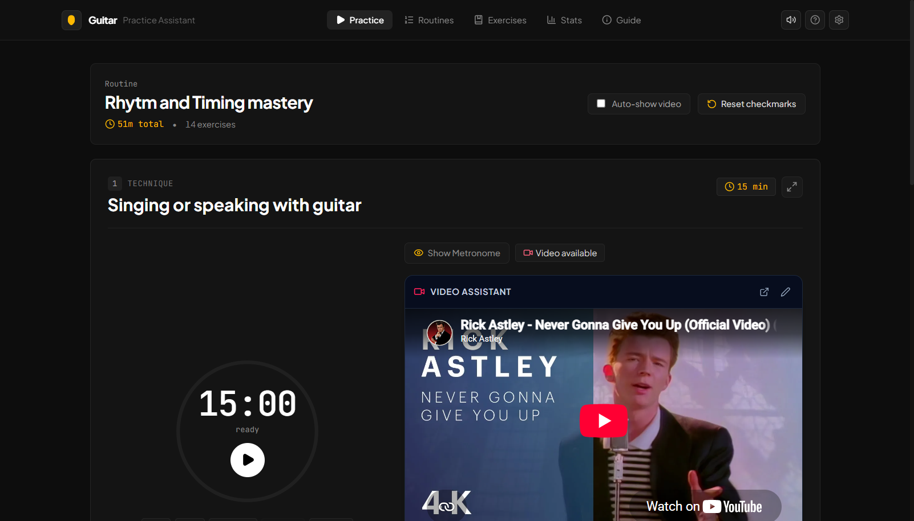
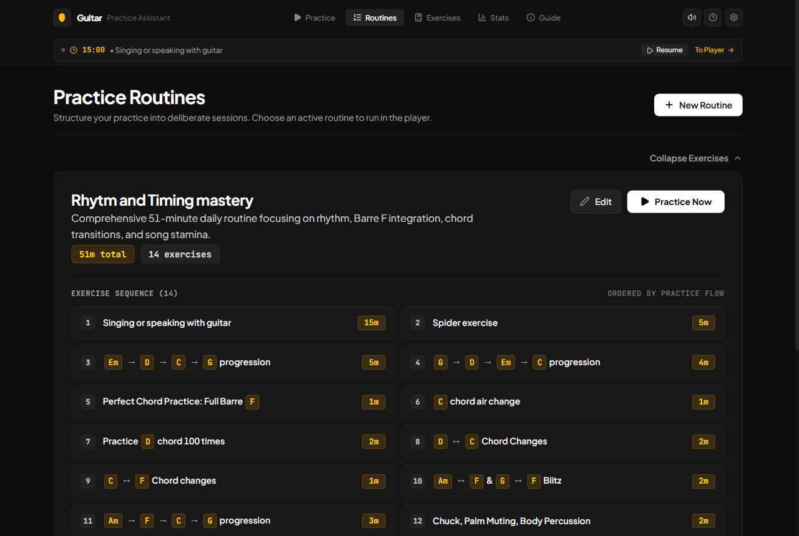
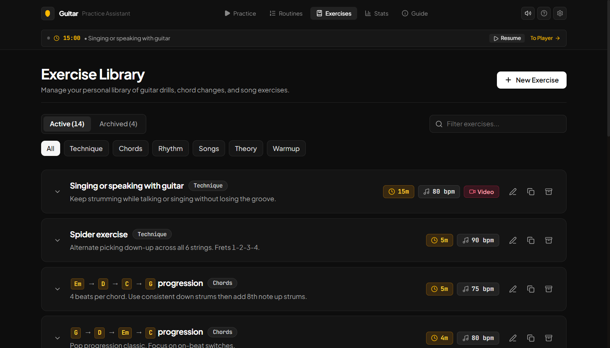
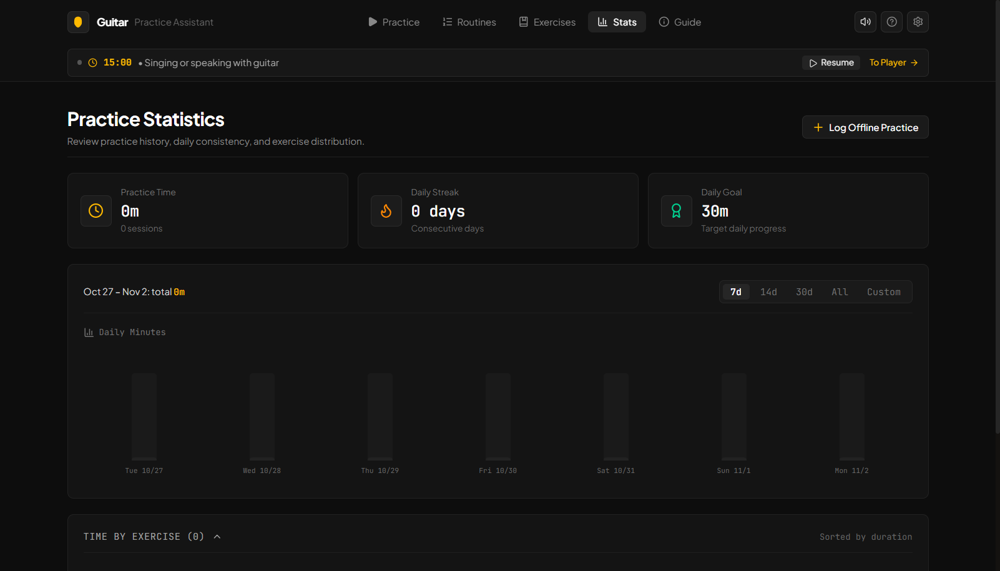

# FretFlow 🎸

> **FretFlow** is a modern, deliberate guitar practice web application inspired by and building upon JustinGuitar's Practice Assistant. Designed with an analog-studio aesthetic, tactile controls, and focused workflow to help guitarists structure routines, stay disciplined, and master their craft.

---

## UI Gallery

| Practice Player | Routines Manager |
| :---: | :---: |
|  |  |
| **Exercise Library** | **Practice Statistics & Analytics** |
|  |  |

---

## Features

### 1. Practice Player (`/practice`)

Interactive practice runner with circular countdown timer, zero-latency synthesizer metronome, chord popups, and instant session logging.

- **Active Routine Runner:** Displays the current active routine (*"Rhythm and Timing mastery"*, 51 mins total across 14 items).
- **Interactive Exercise Flow:**
  - Click any exercise to practice in or out of order.
  - Large circular countdown timer with animated SVG progress ring, Play/Pause, and minute adjustments.
  - Quick action: **"Mark as done – log full scheduled time"** directly from deliberate practice workflow.
  - End-of-item celebration modal with alarm chime sound and options: *Done & Next*, *Repeat Item (+N min)*, or *Stay*.
  - Inline editable **Notes** with instantaneous autosave.
  - Inline editable **Things to Remember** (key technique cues).
  - Status indicators: Green checks for exercises completed this session, reset routine button to clear for the next day.
- **Embedded Audio Metronome:**
  - Zero-latency Web Audio API synthesis (accent click on beat 1).
  - 30 to 260 BPM slider & +/- controls.
  - **Tap Tempo** button for quick rhythm detection.
  - 2/4, 3/4, 4/4, and 6/8 time signatures.
  - Visual beat indicator with glowing accent pulses.
  - Per-exercise BPM memory.
- **Video Assistant:**
  - YouTube player embedded alongside the exercise timer.
  - "Always play with video assistant" checkbox.
  - Inline video URL editing.
- **Interactive Chord Highlighting & Diagrams:**
  - Automatically identifies chords (`Em`, `C ↔ F`, `Am → F → C → G`, etc.) and formats them as clickable badges.
  - Click or hover any chord badge to pop up an interactive SVG guitar chord diagram with finger numbers, base frets, and string markers.

### 2. Routines Manager (`/routines`)

Organize and switch active routines with side-by-side management and item-level duration overrides.

- **Single Active Routine Architecture:** Exactly one active routine running at a time.
- **Side-by-Side View:** Current active routine on the left; inactive/saved routines on the right.
- **One-Click Activation & Deletion:** Switch active routines instantly.
- **Routine Editor Modal:**
  - Add exercises from the library.
  - Reorder items using Move Up / Move Down buttons.
  - Override durations per item within each routine.
  - Automatic live total time recalculation.

### 3. Exercise Library (`/items`)

Comprehensive drill repository with tagging, search, category filters, and duplication.

- **Active vs. Archived Items:** Keep your active drills clean while archiving retired drills without losing history.
- **Search & Category Filters:** Filter by keyword or categories (*Technique, Chords, Rhythm, Songs, Warmup, Theory*).
- **Full CRUD + Duplication:** Create, edit, duplicate variations, archive, restore, and permanently delete.

### 4. Practice Statistics & Analytics (`/stats`)

Track practice consistency, streaks, daily goals, and drill breakdowns.

- **Summary Statement:** Parity with deliberate practice metrics: *"From [Date] to [Date] you practiced — X hours Y mins across Z sessions"*.
- **Interactive Daily Bar Chart:** Visual bar chart of minutes practiced per day (pre-seeded with demo data matching Oct 20–26).
- **Date Range Presets & Custom Filters:** Last 7 Days, Last 14 Days, Last 30 Days, All Time, or Custom From/To dates.
- **Exercise Breakdown:** Ranked list of exercises by minutes practiced with proportional percentage bars.
- **Daily Streak Counter & Goal Tracker:** Tracks consecutive daily practice days and progress against daily goals.
- **Log Offline Practice ("Edit Stats"):** Manually record practice sessions completed away from the app.
- **Raw Log History:** Review and manage historical log entries.

### 5. Practice Guide (`/about`)
- Overview of deliberate guitar practice philosophy: short daily sessions, the 4 pillars (Technique, Chords, Rhythm, Repertoire), using a metronome, and targeting weaknesses.

### 6. Data Backup & Storage
- **100% Local & Private:** All data persists in browser `localStorage`.
- **JSON Export & Import:** Export a single JSON file or copy to clipboard for safe backups across devices.
- **Reset to Defaults:** One-click restore to the original pre-populated practice dataset.

---

## Tech Stack

- **Framework:** [React 19](https://react.dev/) + [TypeScript](https://www.typescriptlang.org/)
- **Styling:** [Tailwind CSS v4](https://tailwindcss.com/)
- **Bundler:** [Vite](https://vitejs.dev/)
- **Icons:** [Lucide React](https://lucide.dev/)
- **Audio:** Web Audio API synthesis (zero-latency metronome click & completion chimes)
- **Visuals:** Canvas Confetti & custom SVG chord diagrams

---

## Quick Start

### Installation

```bash
git clone https://github.com/Abdullah-Zafarr/FretFlow.git
cd FretFlow
npm install
```

### Development Server

```bash
npm run dev
```

Open [http://localhost:5173](http://localhost:5173) in your browser.

### Production Build

```bash
npm run build
npm run preview
```
