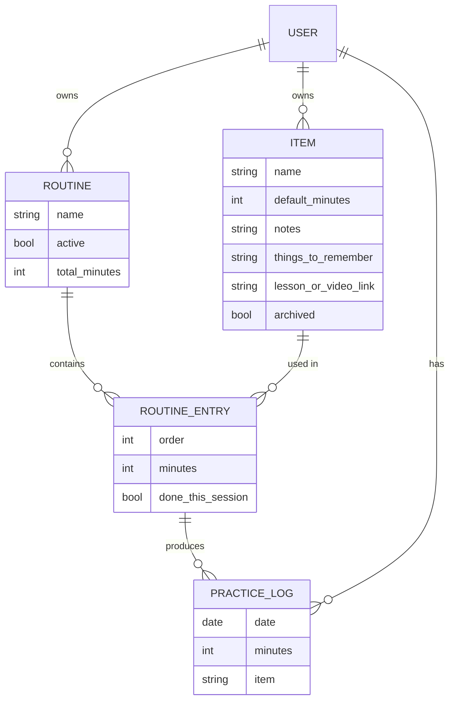

# JustinGuitar "My Practice Assistant": Feature Research

> **Purpose:** List every feature of the JustinGuitar Practice Assistant (PA) so we can decide what to build in our own version.
> **Status:** Research only, no code yet. The next step is for you to review this and add your own ideas (see §10).
>
> **Confidence labels used below:**
> - ✅ **Confirmed**: visible in your screenshots
> - 🌐 **Researched**: found in JustinGuitar's site, forum, or YouTube content
> - 🤔 **Inferred**: a reasonable guess from the UI that still needs checking (you can confirm it on the live site)

---

## 1. Where it lives and how it's organized

| Area | Details | Confidence |
|---|---|---|
| Location | Part of the logged-in justinguitar.com dashboard, under **Practice** in the left sidebar | ✅ |
| Sidebar (whole site) | Dashboard, **Practice**, Favorites, Songbook, Notes, Journey, App, Account | ✅ |
| Page title | "MY PRACTICE ASSISTANT" | ✅ |
| Sub-tabs | **Practice · Routines · Items · Stats · About** | ✅ |
| Help | Each tab has an **ⓘ info icon** (top right) that opens help text for that tab | ✅ / 🤔 (what it shows) |
| Cost | Comes with a free JustinGuitar account | 🌐 |

### Data model (how the parts fit together)

- **Item** = one exercise, drill, or song (for example "C ↔ F Chord changes, 1 min"). It's a reusable building block.
- **Routine** = an ordered list of items, each with a duration. The routine total is the sum of its item durations (your routine: 14 items = **51 mins**).
- **Only one routine is active at a time.** The Practice tab always runs the active routine.
- **Practice logs** = minutes recorded when you finish or mark items. These feed the Stats tab.

---

## 2. Practice tab (the "player")

This is the screen you use every day.

### 2.1 Routine header
| Feature | Details | Confidence |
|---|---|---|
| Routine name | e.g. "Rhytm and Timing mastery" | ✅ |
| Total duration | Clock icon + "TOTAL 51 MINS." (sum of item durations) | ✅ |
| **Reset Routine** | Clears all ✓ marks so you can run the routine again from the top (for example the next day or a second round) | ✅ / 🌐 |
| **"Always play with video assistant"** checkbox | When on, items that have a linked Justin lesson video automatically show/play the video next to the timer while you practice | ✅ / 🌐 |

### 2.2 Active (expanded) item panel
| Feature | Details | Confidence |
|---|---|---|
| Item number + name | e.g. "① Singing or speaking with guitar" | ✅ |
| Scheduled duration | "15 MINS" + clock icon (top right of the panel) | ✅ |
| **Big circular Play button** | Starts the countdown. The ring around it probably fills as a progress indicator. It probably turns into Pause while running | ✅ / 🤔 (pause/progress) |
| **Countdown display** | "⏱ 15:00", counting down to 0 | ✅ |
| **"Mark as done – log full scheduled time"** | Marks the item complete and logs the **full** scheduled minutes to stats, even if you didn't run the timer (useful if you practiced without the app) | ✅ / 🌐 |
| **Notes** section | Your personal notes for this item, with an ✏️ edit button you can use inline during practice | ✅ |
| **Things to Remember** section | Reminders or cues shown while practicing (e.g. "speak random stuff so the guitar goes on autopilot") | ✅ |
| **Show metronome** toggle | 👁 "show metronome" shows an embedded metronome under the timer | ✅ |
| Video assistant | If the item is linked to a Justin lesson, the lesson video can be shown or played alongside the timer | 🌐 |

### 2.3 What happens when the timer ends (end-of-item flow)
| Feature | Details | Confidence |
|---|---|---|
| Alarm / sound when time is up | Tells you to switch exercises | 🌐 / 🤔 |
| **Done / log time** | Logs the time and marks the item ✓ | 🌐 |
| **Repeat item** | Runs the same item again (extra time on hard things) | 🌐 |
| **Next / skip** | Moves to the next item without finishing this one | 🌐 |
| Auto-advance | After you finish an item, the next unfinished item expands | 🤔 |
| Partial time logging | If you stop early, it probably logs only the time actually spent | 🤔 |

### 2.4 Routine item list (below the active item)
| Feature | Details | Confidence |
|---|---|---|
| Ordered list of all items in the routine, each with its duration | e.g. "Spider exercise … 5 MINS 🕒" | ✅ |
| **Status icons** | ✓ in a circle = done this session. A grey number badge = not done yet | ✅ |
| **Items can be done out of order** | In your screenshot #3 is not done while #2 and #4–#10 are done, so you can click any item to make it active | ✅ |
| **Chord names highlighted** | Chord tokens inside item names (Em, D, C, G, F, Am…) appear in a different color and probably link to chord diagrams or pop-ups | ✅ (color) / 🤔 (link) |
| Arrow notation in names | "→" means a progression, "↔" means a back-and-forth change | ✅ |

### 2.5 Metronome (embedded)
| Feature | Details | Confidence |
|---|---|---|
| Start/stop, BPM control | Standard metronome | 🌐 |
| Accent on beat 1 / time signature | Justin focuses a lot on hearing the "1" | 🌐 |
| Tap tempo | Exists as a separate JustinGuitar web tool. Not confirmed inside the PA | 🌐 (separate tool) |
| BPM saved per item | Not confirmed. **A good feature for our version** | 🤔 |

---

## 3. Routines tab

| Feature | Details | Confidence |
|---|---|---|
| **Current Active Routine** (left column) | Exactly one routine. Has ✏️ edit and **+** expand (shows its items inline) | ✅ |
| **Inactive Routines** (right column) | Your saved routines (Beginner Module 3–7, Consolidation…) | ✅ |
| Per inactive routine: ✏️ **Edit** | Opens the routine editor | ✅ |
| Per inactive routine: 🟢 **Activate** (+) | Makes it the active routine and moves the current one to inactive | ✅ |
| Per inactive routine: 🔴 **Delete** (×) | Removes the routine | ✅ |
| **+ Add New Routine** | Creates a routine from scratch | ✅ |
| **Import Justin's routines** | Each course module (e.g. "Module 5 Practice Routine" lesson) has a **Practice** button under the video that copies the official routine (with its items) into your PA. This is where your "Beginner Module X" routines came from | 🌐 |

### 3.1 Routine editor (what editing probably includes)
| Feature | Confidence |
|---|---|
| Rename routine | 🤔 |
| Add items (pick from your active items, or create a new one) | 🌐 / 🤔 |
| Set or override minutes per item **inside this routine** | 🌐 / 🤔 |
| Reorder items (drag and drop or up/down) | 🤔 |
| Remove an item from the routine (the item itself stays in the library) | 🤔 |
| Total time recalculates automatically | ✅ (total shown) |

---

## 4. Items tab (item library)

| Feature | Details | Confidence |
|---|---|---|
| **Active Items** (left column) | Alphabetical list, each showing a default duration "(N min)" | ✅ |
| Per active item: ✏️ **Edit** | Edit name, minutes, notes, things to remember, and so on | ✅ |
| Per active item: ⧉ **Duplicate** | Copies an item (e.g. to make a variation) | ✅ (icon) / 🤔 (exact behavior) |
| Per active item: 🔴 **Delete / Archive** | The red × probably archives the item (moves it right). Delete in the archive is permanent | ✅ / 🤔 |
| **+ expand** on each item | Shows details inline (notes, linked lesson…) | ✅ (icon) / 🤔 |
| **Archived Items** (right column) | Old or retired items: Chord Perfect *, One Minute Changes *, L1–L7 10 Min Song Practice, Anchor Finger, etc. | ✅ |
| Per archived item: 🟢 **Restore** (+) | Moves it back to Active | ✅ |
| Per archived item: 🔴 **Delete permanently** | | ✅ |
| Justin's pre-made items | Come in automatically when you import module routines (Chord Perfect, One Minute Changes, Song Practice…) and are often linked to a lesson video | ✅ / 🌐 |
| Custom items | You create your own (most of your active list) | ✅ |
| Create new item button | Probably at the bottom of the active list (not visible in the screenshot) | 🤔 |

### 4.1 Item fields
| Field | Confidence |
|---|---|
| Name (chord tokens get highlighted) | ✅ |
| Default duration (minutes) | ✅ |
| Notes | ✅ |
| Things to remember | ✅ |
| Linked lesson / video (for Justin's items, used by the video assistant) | 🌐 |
| Category / skill area (Technique, Chords, Rhythm, Songs…) | ❌ Not present as far as we can tell. **Possible addition** |

---

## 5. Stats tab

| Feature | Details | Confidence |
|---|---|---|
| **Summary sentence** | "From Tuesday Oct 20 to Monday Oct 26 you practiced ⏱ **3 hours 42 mins**" | ✅ |
| **Bar chart** | One bar per day with a minutes label on top (7, 17, 41, 48, 52, 38, 19) and x-axis labels "TUE OCT 20TH"… | ✅ |
| Default range | Last 7 days ending today | ✅ |
| **Date range filter** | From → To date pickers + **FILTER** button | ✅ |
| **Show details** | Expands a breakdown, probably minutes per item/routine for the selected range | ✅ (button) / 🤔 (content) |
| **Edit stats** ✏️ | Manually adjust logged time (for practice done away from the app, or to fix mistakes) | ✅ (button) |
| **View recorded stats** 📈 | Raw log/history of recorded entries, and/or a longer-term chart | ✅ (button) / 🤔 (content) |
| Known community complaints | Users report blank graphs, sync bugs, and (in the past) no way to add past practice. The "edit stats" button seems to be the fix for that | 🌐 |
| Streaks / goals / reminders | **Not present** in the PA as far as we can tell. **Possible addition** | 🤔 |
| Per-exercise scores (e.g. One-Minute-Changes count, BPM progress) | Justin tells students to track these, but on paper or in a separate tool, not in the PA. **A strong candidate for our version** | 🌐 |

---

## 6. About tab
- Explains how to use the PA and Justin's practice philosophy: short daily sessions (~20–30 min for beginners), splitting time across areas (technique, chords, rhythm, songs), and practicing weaknesses, not just what's fun. ✅ (tab exists) / 🌐 (content)

---

## 7. Related JustinGuitar features (outside the PA, could be integrated)

| Feature | What it is | Relevance |
|---|---|---|
| Songbook | Saved songs with chords | Link "Song practice" items to songs |
| Notes (sidebar) | General notes | Our version could merge notes into items/sessions |
| Favorites | Bookmarked lessons | Link items to favorite lessons |
| Journey | Course progress through Grades and Modules | Routines tied to course level |
| Tap Tempo tool / Online Metronome | Separate web tools | Build into the player |
| Time Trainer app | Advanced metronome (speed trainer, muted bars to test internal timing) | Advanced metronome mode |
| Mobile app (Lessons & Songs) | Chord-change trainer, strum machine, song player | Inspiration only |

---

## 8. How your demo routine works in this model

**Active routine:** *Rhytm and Timing mastery*, 14 items, 51 min:

| # | Item | Min | Status (screenshot) |
|---|---|---|---|
| 1 | Singing or speaking with guitar | 15 | ▶ active |
| 2 | Spider exercise | 5 | ✓ |
| 3 | Em → D → C → G progression | 5 | not done |
| 4 | G → D → Em → C progression | 4 | ✓ |
| 5 | Perfect Chord Practice: Full Barre F | 1 | ✓ |
| 6 | C chord air change | 1 | ✓ |
| 7 | Practice D chord 100 times | 2 | ✓ |
| 8 | D ↔ C Chord Changes | 2 | ✓ |
| 9 | C ↔ F Chord changes | 1 | ✓ |
| 10 | Am ↔ F & G ↔ F Blitz | 2 | ✓ |
| 11 | Am → F → C → G progression | 3 | not done |
| 12 | Chuck, Palm Muting, Body Percussion | 2 | not done |
| 13 | explore new song chords | 3 | not done |
| 14 | Song practice playalong | 5 | not done |

**Weekly stats:** 3 h 42 m over Oct 20–26 (7 / 17 / 41 / 48 / 52 / 38 / 19 min).

> [!NOTE]
> Your Items library has **~40 active custom items** and **~35 archived** (mostly Justin's imported items). Our version should make it easy to **migrate this data**, either by manual entry or a one-time import (e.g. paste a list or a JSON/CSV).

---

## 9. Feature checklist (full parity with JustinGuitar)

**Practice player**
- [ ] Show active routine name and total time
- [ ] Ordered item list with done/pending status
- [ ] Click any item to make it active (out-of-order allowed)
- [ ] Countdown timer per item with play/pause and a progress ring
- [ ] End-of-timer sound + Done / Repeat / Next options
- [ ] "Mark as done – log full scheduled time"
- [ ] Inline-editable Notes and Things to Remember per item
- [ ] Embedded metronome (show/hide)
- [ ] Optional video/lesson link per item ("video assistant")
- [ ] Reset routine
- [ ] Chord names highlighted in item titles

**Routines**
- [ ] Create / edit / delete routines
- [ ] One active routine; activate another with one click
- [ ] Add, remove, and reorder items; set per-routine minutes
- [ ] Expand a routine to preview its items

**Items**
- [ ] Create / edit / duplicate items
- [ ] Archive / restore / permanently delete
- [ ] Fields: name, default minutes, notes, things to remember, link

**Stats**
- [ ] Total time for a date range
- [ ] Daily bar chart
- [ ] Date range filter (default last 7 days)
- [ ] Details breakdown (per item / per routine)
- [ ] Manually edit or add logged time
- [ ] View raw recorded log

---

## 10. Gaps and ideas for your input (things JustinGuitar doesn't do well or at all)

Ideas to discuss. **You decide which ones matter:**

1. **Exercise scores**: log One-Minute-Changes counts, BPM reached, or a 1–5 self-rating per item, and chart progress over time.
2. **Per-item metronome BPM memory**: the metronome remembers the last BPM per exercise.
3. **Streaks and daily goal**: e.g. "45 min/day" with a streak counter and a calendar heatmap.
4. **Session journal**: a short note per day ("felt sloppy on F barre").
5. **Categories/tags** for items (Technique, Chords, Rhythm, Songs, Ear) plus a time-per-category pie chart.
6. **Auto-advance + voice/sound cues** so you never touch the screen while playing.
7. **Fullscreen "focus mode"** with a large timer readable from across the room.
8. **Routine scheduling**: different routines on different weekdays.
9. **Offline / PWA / mobile-friendly** use, installable on your phone.
10. **Data import/export** (JSON/CSV backup) and the option to stay fully local (no account).
11. **Chord diagram pop-ups** when you hover or tap a chord name in an item.
12. **Song library** linked to "song practice" items (chords, strumming pattern, YouTube link).
13. **Recording**: record yourself during an item and listen back later.

---

## 11. Open questions for you

1. **Platform:** web app on your laptop only, or should it also work well on your phone (PWA)?
2. **Accounts/sync:** single user stored locally in the browser, or a backend with login so it syncs across devices?
3. **Videos:** do you want a "video assistant", e.g. attach a YouTube link to an item and play it embedded?
4. **Data migration:** should we import your current routines/items (I can transcribe them from your screenshots)?
5. **Which ideas from §10** do you want in v1, and which later?
6. **Look and feel:** copy JustinGuitar's style, or use your own design (dark mode, etc.)?
